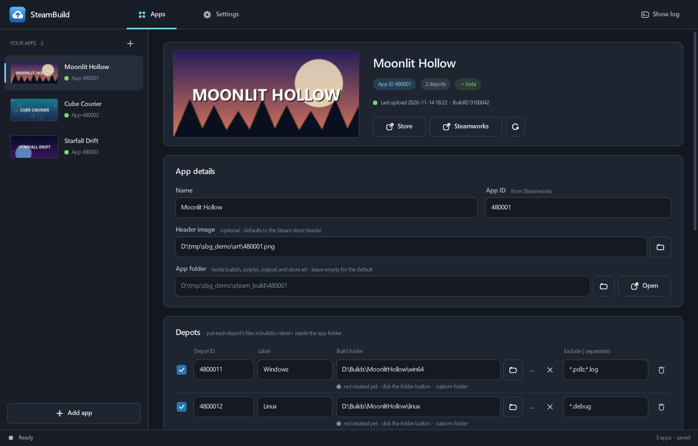
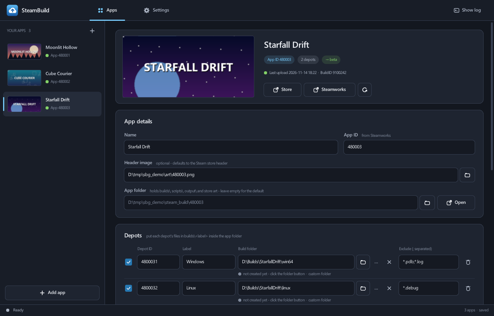
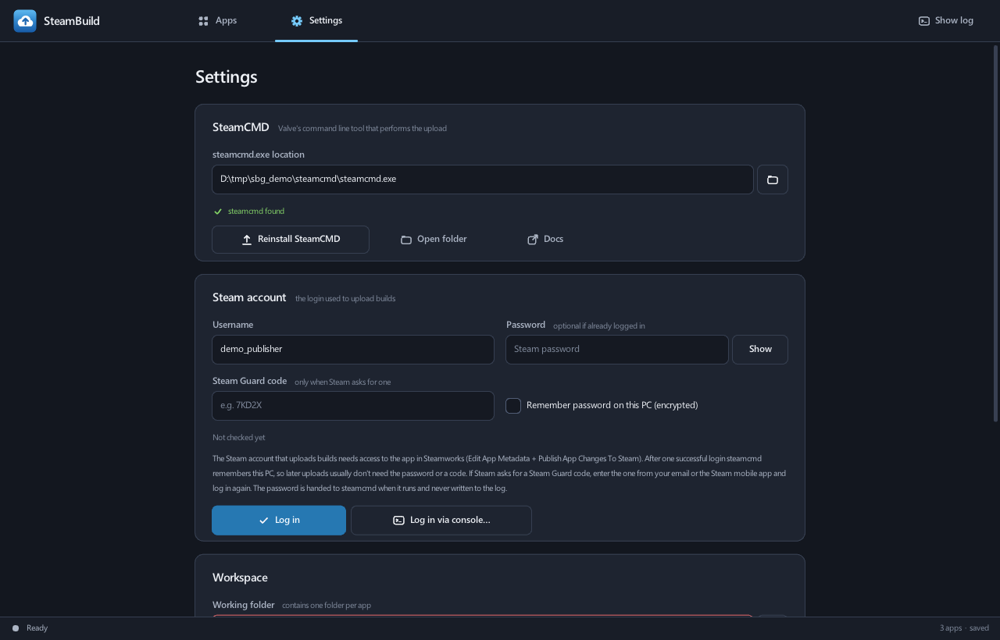

# SteamBuildGui

A small, fast desktop app for uploading your game builds to Steam. It's a friendlier alternative to Valve's SteamPipeGUI, written in [Odin](https://odin-lang.org) with raylib.



## Features

- **All your games in one list.** Each app shows its Steam store header art, which is downloaded automatically, or you can pick your own image.
- **Depots made simple.** Give each depot an ID, a label, a build folder, and exclusions (`*.pdb;*.log`). Tick the ones you want to upload.
- **One-click upload.** The app writes the SteamPipe VDF scripts and runs `steamcmd` for you, and you can watch its output live in the log panel.
- **Branches and preview builds.** You can set a branch live after the upload, or do a dry run that builds the manifest without uploading anything.
- **Build history.** Each app keeps its recent uploads with time, BuildID, branch, and result.
- **SteamCMD installer.** If you don't have steamcmd yet, the app can download it with one click.
- **Safe login.** Your password is passed only to steamcmd and is never written to the log. If you choose to remember it, it's encrypted with Windows DPAPI, or stored in the Keychain on macOS.





## Requirements

- Windows 10 or 11, or macOS 11+ (Apple Silicon or Intel)
- The [Odin compiler](https://odin-lang.org/docs/install/) on your `PATH` (only needed to build the app)
- A Steamworks account with permission to upload builds for your app

## Build

```bat
build.bat          :: optimized build -> bin\SteamBuildGui.exe
build.bat debug    :: debug build with a console window
build.bat icon     :: regenerate SteamBuildGui.ico, then build
```

On macOS (double-click in Finder or run in Terminal):

```sh
./MacOs_InstallOdin.command   # one-time: Xcode CLT + Homebrew + Odin
./MacOs_Build.command         # optimized build -> bin/SteamBuildGui.app
./MacOs_Build.command debug   # debug binary -> bin/SteamBuildGui
```

## Quick start

1. Run `bin\SteamBuildGui.exe`.
2. **Settings:** install or locate `steamcmd.exe`, enter your Steam username, and log in once. Steam Guard is supported.
3. **Apps:** click **Add app** and enter your App ID. The name and store art are filled in for you.
4. Add your depots and point each one at a build folder.
5. Set a description and an optional branch, then upload.

## Where things are stored

Everything is kept next to the exe in `bin\` (on macOS the `.app` uses `~/Library/Application Support/SteamBuildGui/` instead):

| Path                 | What                                                  |
|----------------------|-------------------------------------------------------|
| `steambuildgui.json` | Your apps, depots, and settings                       |
| `steamcmd\`          | SteamCMD (`steamcmd.sh` on macOS), if installed through the app |
| `steam_build\`       | One folder per app: scripts, output, logs, cached art |

## License

This project is licensed under the MIT license. See [LICENSE](LICENSE).

It uses [raylib](https://www.raylib.com), which ships with Odin under the zlib license. Fonts are loaded at runtime from your Windows or macOS install and are not included. SteamCMD is not bundled either: the app downloads it straight from Valve. This project is not affiliated with Valve or Steam.

---

*The screenshots use made-up demo games and IDs.*
